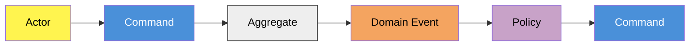

# Event Storming notation

## Canonical color legend

Use [ddd-crew/eventstorming-glossary-cheat-sheet](https://github.com/ddd-crew/eventstorming-glossary-cheat-sheet) as the canonical source for color-to-element mapping. Other write-ups disagree on a few assignments (Read Model and Constraint especially), and mixing conventions within one session makes the output inconsistent.

| Color | Element | Meaning |
| --- | --- | --- |
| Orange | Domain Event | Something that happened, named in the past tense. |
| Blue | Command / Action | An intent to change state, named in the imperative. |
| Lilac | Policy | A reactive rule: "whenever X, do Y." |
| Small Yellow | Actor | The role that triggers a command. |
| Green | Query / Read Model | Data read to support a decision. |
| Large Yellow | Constraint | A business rule that limits what's possible. |
| Wide Pink | External System | A system outside the modeled domain. |
| Neon Pink | Hotspot | An open question, disagreement, or risk. |

## Deliverable templates

### Scenarios covered

| Scenario | Actor | Trigger | Outcome |
| --- | --- | --- | --- |
| ... | ... | ... | ... |

### Command / Event / Aggregate

| Command | Actor | Aggregate | Domain Event(s) |
| --- | --- | --- | --- |
| ... | ... | ... | ... |

### Aggregates

| Aggregate | Contains | Invariant / reason for boundary | Notes |
| --- | --- | --- | --- |
| ... | ... | ... | ... |

### Policies and derivations

| Trigger | Rule | Result | Type |
| --- | --- | --- | --- |
| ... | ... | ... | Policy (produces an event) / Derivation (computed, no event) |

### Ubiquitous language

| Term (domain language) | Code name | Meaning | Avoid |
| --- | --- | --- | --- |
| ... | ... | ... | (rejected synonyms — the column that does the most to stop vocabulary drift) |

## Diagram (optional)

Tables are canonical. A diagram can help a reader see flow at a glance, but it isn't kept as the source of truth — it goes stale the moment a table changes, and one arrow chaining a read model into an event into a command into an aggregate tends to blur causality with mere time order. Use one only if it earns its keep.

